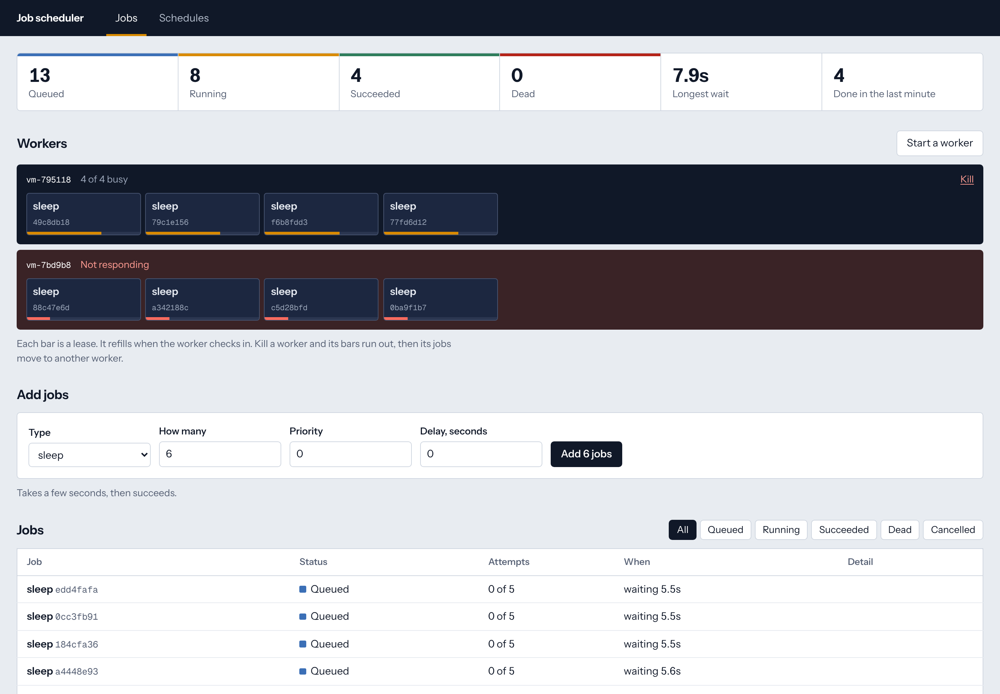
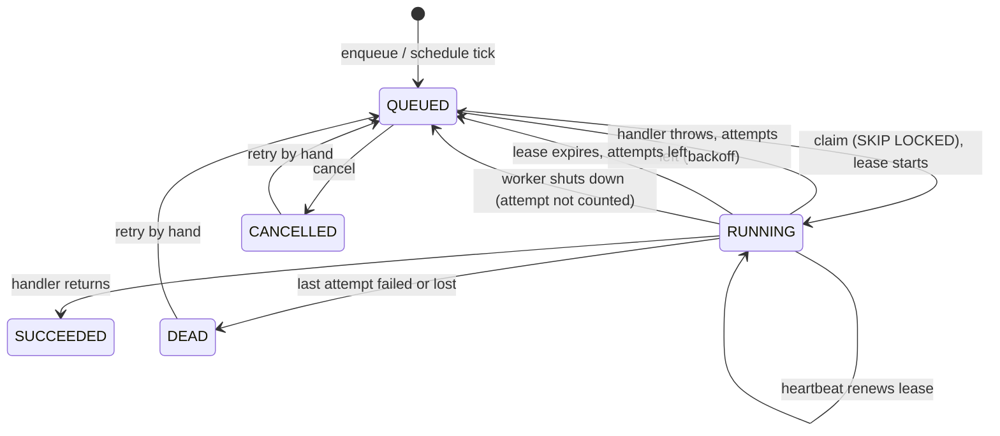
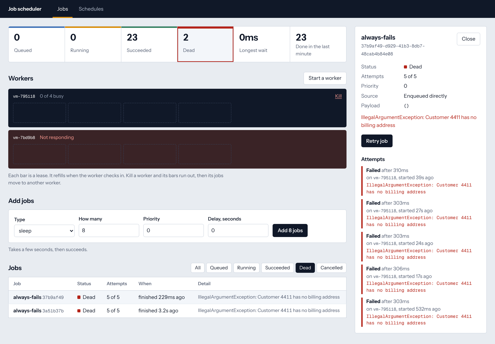
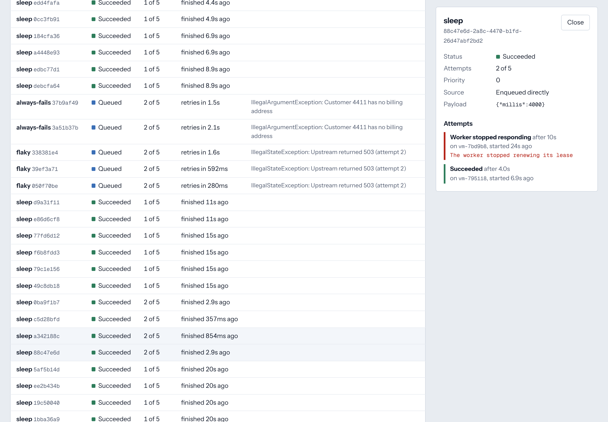

# Job scheduler: a Postgres queue that survives its workers

[](../../actions/workflows/ci.yml)

A background job scheduler with any number of competing workers and no coordinator. It is built around three guarantees, each backed by tests against a real Postgres:

1. **No two workers run the same job at the same time**, however many are polling.
2. **A job whose worker dies is finished by another.** And if the first worker turns out to be alive after all, its late result is refused.
3. **A cron schedule makes one job per tick**, however many instances notice the tick.

Spring Boot 4.1 / Java 21 / Postgres 16 on the back, React 18 / TypeScript on the front. Postgres is the only moving part: no Redis, no broker, no leader election.



*Two workers, eight jobs in progress, and the second worker has just been killed. Each bar is a lease. The live worker's bars refill at every heartbeat; the dead worker's are running out, and when they do its four jobs go back in the queue.*

## The problem

**Two workers, one job.** The obvious queue is `SELECT … WHERE status = 'QUEUED' LIMIT 1`, then `UPDATE`. Two workers that run the `SELECT` at the same moment both get the same row, and the customer gets two emails. Adding `FOR UPDATE` fixes that and makes every worker wait in line behind the first, so ten workers are as fast as one.

**A worker that dies.** A worker takes a job, marks it running, and the process is killed. Nothing will ever mark that job finished. Without a way to notice, it stays "running" forever.

**A worker that only looked dead.** So you add a timeout and give the job to someone else. But the first worker was not dead. It was in a long garbage-collection pause, or cut off from the network, and now it comes back, finishes, and writes "succeeded" over a job that somebody else is halfway through.

**Cron on more than one machine.** Run the scheduler on three instances for availability, and at 02:00 all three decide it is time for the nightly report.

## How it works



### Claiming

```sql
UPDATE jobs SET status = 'RUNNING', attempts = attempts + 1, locked_by = :worker,
                lease_expires_at = now() + :lease
WHERE id IN (SELECT id FROM jobs
             WHERE queue = :queue AND status = 'QUEUED' AND run_at <= now()
             ORDER BY priority DESC, run_at, id
             FOR UPDATE SKIP LOCKED
             LIMIT :free_slots)
RETURNING *
```

`SKIP LOCKED` is the whole trick. Each worker locks the rows it selects, and a worker that meets a locked row skips it and takes the next one. No two claims return the same job, and none waits for another. A partial index on queued rows, in claim order, keeps the scan short however many finished jobs the table holds.

A worker only claims as many jobs as it has free slots, so a job is never held idle by one worker while another has room.

### Leases and heartbeats

A claim is a lease, not ownership. While a job runs, the worker's heartbeat extends the lease; a job can run for hours on a 30-second lease. If the heartbeats stop, the lease runs out, and every instance's reaper will put the job back in the queue (or mark it dead, if that was its last attempt).

The lease length therefore bounds how long a failure goes unnoticed, not how long a job may take.

### Fencing

Every report from a worker names the attempt it was given:

```sql
UPDATE jobs SET status = 'SUCCEEDED', …
WHERE id = :id AND status = 'RUNNING' AND locked_by = :worker AND attempts = :attempt
```

A worker that lost its lease no longer matches. Its update changes zero rows and its result is discarded, whether the job has since been finished by someone else or is still in progress. The same heartbeat that renews leases also tells a worker which ones it has lost, and it interrupts the handler so two workers are not both doing the work for long.

This makes the guarantee **at-least-once**: a job whose worker dies after doing the work but before saying so will run again. Handlers must be safe to repeat. Exactly-once needs the handler's side effect and the status update in one transaction, which a general-purpose scheduler cannot promise for arbitrary work.

### Retries

A failed attempt goes back in the queue with `run_at` in the future: the base delay doubled per attempt, capped, with random jitter between half and all of it. The jitter matters when one outage fails many jobs at once; without it they all return together, and again, in waves. After the last attempt the job is **dead**: it stays in the table with its error and its history, and waits for a person to retry it.



### Schedules

Every instance checks for due schedules about once a second. A due schedule is read `FOR UPDATE SKIP LOCKED`, so normally one instance handles it, and the job it inserts is unique on `(schedule_id, scheduled_for)`, so even if two did, the second insert does nothing.

Ticks that came due while nothing was running are not replayed. The schedule fires once, for the most recent missed tick, and resumes from now.

### Shutting down

A worker that is asked to stop gives its jobs a grace period, then hands back whatever is still running: the job returns to the queue immediately and the attempt is not counted. A deploy does not strand jobs for a lease length or use up their retries.

### One clock

Every timestamp comes from the database's `now()`. Instances whose own clocks disagree still agree on when a job is due and when a lease has expired.

## What the tests prove

Integration tests run the application against a real Postgres. Each test starts its own workers on its own queue, with leases of one second so that failures play out quickly.

| Test | What must hold |
|---|---|
| `competingWorkersRunEveryJobExactlyOnce` | 400 jobs, 4 workers × 5 slots: every job ran once, and all four workers took part |
| `simultaneousClaimsNeverReturnTheSameJob` | 12 threads draining 300 jobs: 300 distinct ids claimed |
| `aCrashedWorkersJobIsTakenOverAndItsLateResultIsRefused` | A worker goes silent mid-job. Another takes over. The first then finishes and reports success *while the second is still working*: the job stays the second worker's |
| `aKilledWorkersJobsAreAllFinishedByAnother` | Three jobs die with their worker; all three finish elsewhere, each showing a lost attempt and a successful one |
| `aJobLongerThanItsLeaseKeepsItByHeartbeating` | A 3 s job on a 1 s lease, with an idle worker waiting to take it: runs once |
| `aWorkerThatLosesItsLeaseStopsWorkingOnTheJob` | Lease expired under a live worker: its handler is interrupted |
| `losingTheLastAllowedAttemptToACrashMakesTheJobDeadNotStuck` | No job is left "running" with nobody running it |
| `shuttingDownHandsUnfinishedJobsBackWithoutSpendingAnAttempt` | Back in the queue at once, attempts still 0, picked up within 2 s |
| `aFailedJobIsRetriedAfterAGrowingDelayUntilItSucceeds` | Fails twice, succeeds on the third; the gaps respect the backoff |
| `aJobThatNeverSucceedsEndsUpDeadAndCanBeRetriedByHand` | Exactly `maxAttempts` runs, then nothing until retried |
| `jobsRunInPriorityOrderThenOldestFirst`, `aDelayedJobDoesNotRunEarly`, `aWorkerNeverHoldsMoreJobsThanItHasSlots` | Ordering, delay and back-pressure |
| `aTickProducesOneJobHoweverManyInstancesNoticeIt` | 8 threads calling the scheduler in a tight loop for 4 s on a per-second schedule: one job per second, none missing, none doubled |
| `ticksMissedWhileNothingWasRunningAreNotReplayed` | Three hours behind: one job, for the latest tick |
| `theSameIdempotencyKeySentManyTimesAtOnceMakesOneJob` | 10 simultaneous POSTs: one 201, nine 200, one row |

38 backend tests (11 unit, 27 integration) and 14 dashboard tests.

Two mutations were tried against the suite to check that it bites. Removing the row lock from the claim failed the concurrency tests. Removing the fencing condition failed the crashed-worker test.

The suite also found a real bug while it was being written: a handler thread interrupted in the middle of a database call (because its lease was lost) surfaced the interrupt as a connection error, and the worker then tried to record that "failure" on the same interrupted thread. An interrupt now means the job is abandoned, not failed, and an outcome that cannot be written is left for the lease to recover.

## Design decisions

- **Postgres as the queue.** For jobs created by a database transaction, the queue being in the same database means "save the order and enqueue the email" is atomic with no outbox. The cost is throughput: every claim is a write, and a queue doing tens of thousands of jobs a second belongs on a log or a broker.
- **Polling, not `LISTEN/NOTIFY`.** Workers poll every 500 ms, so an idle job waits up to that long. A notification on enqueue would remove the wait; polling was kept because it has no failure mode of its own, and a notify could be added on top without changing anything else.
- **No leader.** Every instance runs the reaper and the cron loop. The statements are safe to run concurrently, so there is no election to get wrong and no single instance whose loss stops schedules.
- **The attempt number as the fencing token.** A separate token would do the same job; the attempt counter already changes on every claim and is already in the row.
- **Finished jobs stay in the table.** They are the audit trail, and the partial indexes keep them out of the hot path. A production deployment would add a retention job to delete old ones.
- **A lease must be at least twice the heartbeat interval**, checked at startup. With less margin, one slow heartbeat loses every job the worker holds.

## Not implemented

- No authentication on the API or dashboard; it is meant to sit on an internal network.
- A running job cannot be cancelled, only a queued one.
- Jobs have no per-job timeout beyond the handler's own.
- One queue per deployment in the API (the store supports many; the tests use that).
- No retention of finished jobs.

## Running it

You need Docker.

```bash
./run-local.sh        # docker compose up --build
```

This starts Postgres and **two** instances, on http://localhost:8080 and http://localhost:8081, sharing one queue. Add some jobs, then kill a worker and watch its jobs move.

For development (Java 21 and Node 22):

```bash
docker compose up -d postgres
./mvnw spring-boot:run
cd frontend && npm install && npm run dev      # http://localhost:5173
```

Tests:

```bash
./mvnw verify                      # needs Docker, for Testcontainers
cd frontend && npm test
```

To run the integration tests against an existing Postgres instead, set `JOBS_TEST_DB_URL`, `JOBS_TEST_DB_USER` and `JOBS_TEST_DB_PASSWORD`.

### Writing a handler

```java
@Component
class SendReceipt implements JobHandler {

    public String type() {
        return "send-receipt";
    }

    public void handle(JobContext context) throws Exception {
        String orderId = context.payload().get("orderId").asString();
        // Do the work. Throw to fail the attempt. Be safe to run twice.
    }
}
```

## API

| Method | Path | |
|---|---|---|
| `POST` | `/api/jobs` | Enqueue. `type`, optional `payload`, `priority`, `delaySeconds`, `maxAttempts`, `count`. With an `Idempotency-Key` header: 201 for a new job, 200 for the existing one |
| `GET` | `/api/jobs?status=&limit=` | Newest first |
| `GET` | `/api/jobs/{id}` | The job and every attempt: worker, times, outcome, error |
| `POST` | `/api/jobs/{id}/cancel` | Queued jobs only; otherwise 409 |
| `POST` | `/api/jobs/{id}/retry` | Dead or cancelled jobs only; otherwise 409 |
| `GET`, `POST` | `/api/schedules` | Six-field cron, UTC |
| `PUT` | `/api/schedules/{id}/enabled` | Pause and resume |
| `DELETE` | `/api/schedules/{id}` | Jobs it already made are kept |
| `GET` | `/api/overview` | Counts, queue lag, throughput, workers and what each is running |
| `POST`, `DELETE` | `/api/workers`, `/api/workers/{id}` | Start another worker in this instance; kill one without letting it hand anything back |

Errors are RFC 9457 problem documents.


